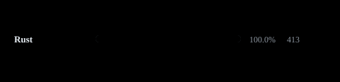

# GitHub Language Stats

A lightweight Rust CLI tool that generates language statistics SVG charts from [cloc](https://github.com/AlDanial/cloc) output and optionally updates your repository's README.

<!-- LANG_STATS_START -->
<p align="center"></p>
<!-- LANG_STATS_END -->

## Features

- Generate SVG language statistics charts.
- Sort languages by code line count.
- Group smaller languages into `Other`.
- Customize excluded directories and languages.
- Automatically update README sections.
- Integrate with GitHub Actions.
- No external SVG rendering dependency.

## Requirements

- Rust (stable toolchain)
- [cloc](https://github.com/AlDanial/cloc)

## Installation

Clone the repository and build:

```bash
git clone https://github.com/XtremeRahul007/github-language-stats.git
cd github-language-stats
cargo build --release
```

The executable will be available under `target/release/`.

## Usage

Generate statistics directly from the current repository:

```bash
github-language-stats \
  --input - \
  --exclude-dir=node_modules,target,dist,.git,.github \
  --exclude-lang=JSON,Markdown,TOML \
  --output docs/language-stats.svg \
  --readme README.md \
  --max-rows 8
```

You can also provide an existing cloc JSON file:

```bash
github-language-stats --input stats.json
```

### Available options

| Option           | Default                   | Description                               |
| ---------------- | ------------------------- | ----------------------------------------- |
| `--input`        | `stats.json`              | Input cloc JSON file; use `-` to run cloc |
| `--output`       | `docs/language-stats.svg` | Generated SVG path                        |
| `--readme`       | `README.md`               | README file to update                     |
| `--max-rows`     | `8`                       | Maximum chart rows, including Other       |
| `--exclude-dir`  | None                      | Comma-separated directories to exclude    |
| `--exclude-lang` | None                      | Comma-separated languages to exclude      |
| `--help`         | —                         | Display help                              |
| `--version`      | —                         | Display version                           |

## README Integration

You can automatically display the generated language statistics in your repository's README.

1. Add the following marker pair to your `README.md`, exactly where you want the chart to appear:

   ```html
   &lt;!-- LANG_STATS_START --&gt; &lt;!-- LANG_STATS_END --&gt;
   ```

2. The tool replaces the content between these markers with the generated SVG image.

3. Configure the output path using `--output` and provide your README path using `--readme`.

**Important:** Keep exactly one start marker and one end marker in your README. Place them outside Markdown code blocks so the generated image renders correctly.

## GitHub Actions

You can automate updates whenever you push to your main branch.

Create `.github/workflows/language-stats.yml`:

```yaml
name: Update Language Statistics

on:
  push:
    branches:
      - main
  workflow_dispatch:

permissions:
  contents: write

jobs:
  update-stats:
    runs-on: ubuntu-latest

    steps:
      - uses: actions/checkout@v4

      - uses: dtolnay/rust-toolchain@stable

      - name: Install cloc
        run: |
          sudo apt-get update
          sudo apt-get install -y cloc

      - name: Generate statistics
        run: |
          cargo run --release -- \
            --input - \
            --exclude-dir=node_modules,target,dist,build,.git,.github \
            --exclude-lang=JSON,Markdown,TOML,SVG \
            --output docs/language-stats.svg \
            --readme README.md \
            --max-rows 8

      - name: Commit changes
        run: |
          git config user.name "github-actions[bot]"
          git config user.email "41898282+github-actions[bot]@users.noreply.github.com"

          git add README.md docs/language-stats.svg

          if ! git diff --cached --quiet; then
            git commit -m "chore: update language statistics"
            git push
          fi
```

Enable **Read and write permissions** under your repository's Settings → Actions → General → Workflow permissions.

## Development

Run tests:

```bash
cargo test
```

Check formatting and linting:

```bash
cargo fmt --check
cargo clippy -- -D warnings
```

## License

MIT License. See [LICENSE](LICENSE).
