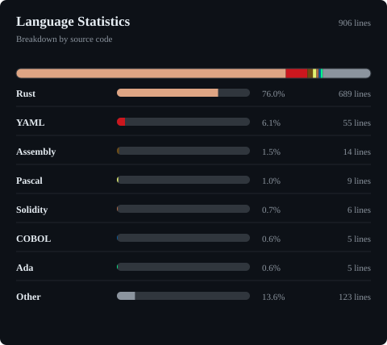
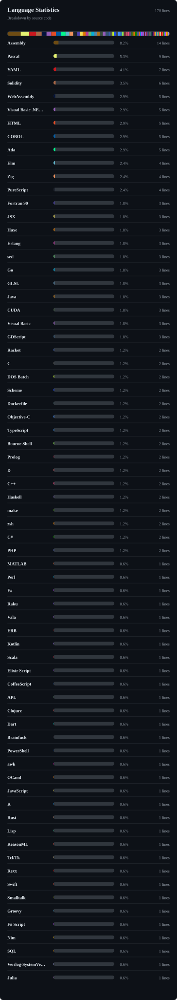

# Samples

Here are some examples of language statistics charts generated by GitHub Language Stats.

## Example

  

## Supported Languages

**75 languages supported.**

  

[← Back to Main README](../README.md)
